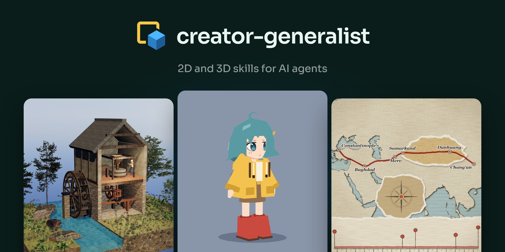
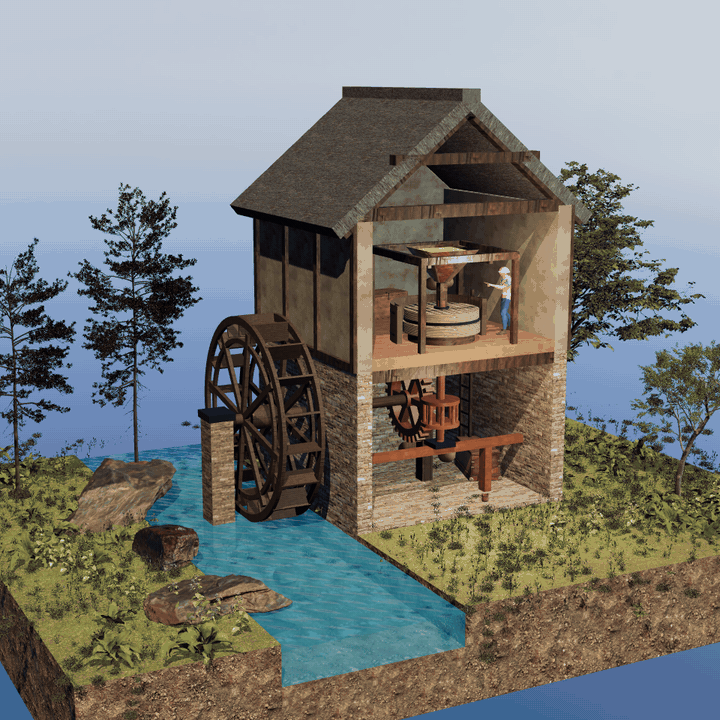
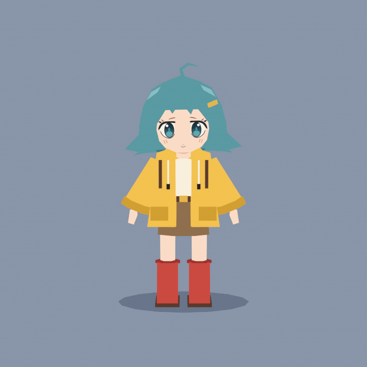
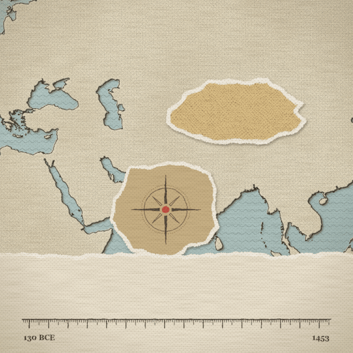

<p align="center">
  
</p>

<p align="center">
  <a href="LICENSE"></a>
  
  
  
</p>

Install the pack one time. After that, your agent can work like a 2D and 3D generalist and a small game studio.
Use it to make content, videos and Shorts for YouTube, TikTok, Facebook, Instagram and X.
You do not call a skill by name. Ask for the work and the matching skill loads, or start one with `/3dg`, `/2dg` or `/gameg`.
Before it builds, the agent asks a few short questions about whatever your request leaves open (purpose, platform, format, look), each with a suggested answer. It then shows a cheap preview, so the result matches what you meant.

## One prompt, one result

Each clip below came from the prompt above it, made with these skills for this README.

<table>
  <tr>
    <td width="33%" valign="top"><code>/3dg cutaway a 14th-century water mill, wheel turning the millstones</code></td>
    <td width="33%" valign="top"><code>/3dg character turn this turnaround sheet into a low-poly anime character</code></td>
    <td width="33%" valign="top"><code>/2dg map the Silk Road from Chang'an to Constantinople with a true-scale timeline</code></td>
  </tr>
  <tr>
    <td></td>
    <td></td>
    <td></td>
  </tr>
</table>

## The skills

Three main skills run the whole piece. They call the craft and tool skills for each step, and you can ask for any of
those on its own too.

**Main skills**

| Skill | Ask for | You get |
|---|---|---|
| **[3d-generalist](plugins/3d-generalist/skills/3d-generalist/SKILL.md)** | a 3D Short, a cutaway build, a story scene, a world, a rigged character, a hero asset | A scripted and animated 3D piece in Blender, Three.js or [67js](https://github.com/codepawl/67.js), built from real CC0 and CC BY scans and checked by a QA gate before you see a preview |
| **[2d-generalist](plugins/2d-generalist/skills/2d-generalist/SKILL.md)** | a Vox or Johnny Harris style explainer graphic | A footage-led Vox look with flat paper cards, print-bordered real photos, highlighters, maps, charts and true-scale timelines (torn paper, halftone and grain only as opt-in stylised looks), made with free tools |
| **[game-generalist](plugins/game-generalist/skills/game-generalist/SKILL.md)** | a game prototype, a small original game, a game jam entry, a feel and QA pass on a playable | A playable greybox you try before any art, a locked look, an original game on web (three.js, Phaser, canvas), Godot, Unity or Unreal, and a playtest report from scripted bots (errors, win and lose paths, restart, determinism, frame time, softlocks) with a playable link and a 30 to 60 s capture |

**Craft skills**

| Skill | Ask for | You get |
|---|---|---|
| **[model-characters](plugins/3d-generalist/skills/model-characters/SKILL.md)** | a 3D character from a drawing, a turnaround or an idea | Routes for low poly (PS1, N64, chibi, anime, mascot), stylized sculpt, clean base mesh and realistic humans, with a reference measurer and a mesh checker |
| **[sculpt-models](plugins/3d-generalist/skills/sculpt-models/SKILL.md)** | a sculpted head, creature, rock, cliff or worn prop | Form hierarchy and anatomy, surface layers by scale, rock and terrain fracture logic, Blender 5.x sculpt tools, retopo and bake, a silhouette and mesh checker, and a procedural rock example |
| **[animate-characters](plugins/3d-generalist/skills/animate-characters/SKILL.md)** | character motion in 2D or 3D | The 12 principles for both media, timing and spacing, Graph Editor curves, walk and idle cycles, acting beats, face swaps, frame by frame in Krita and Grease Pencil, cut-out |
| **[rig-characters](plugins/3d-generalist/skills/rig-characters/SKILL.md)** | a rig for a character, face, prop or puppet | Bone naming, Rigify, weights, IK with poles, IK/FK snapping, face rigs, mechanical rigs, 2D cut-out rigs and export to Unity, Godot and glTF |
| **[draw-and-paint-art](plugins/2d-generalist/skills/draw-and-paint-art/SKILL.md)** | drawing, painting or a figure check | Gesture and construction, anatomy and foreshortening, light and form, colouring grayscale, Krita and Grease Pencil, turnaround sheets for 3D |
| **[paint-stylized-backgrounds](plugins/2d-generalist/skills/paint-stylized-backgrounds/SKILL.md)** | a background in any style | Blender render settings, 3D blockout and paint-over, brushes, time-of-day variants, parallax, wind, water and particle effects |

**Tool skills**

| Skill | Ask for | You get |
|---|---|---|
| **[use-3d-software](plugins/3d-generalist/skills/use-3d-software/SKILL.md)** | any step in Blender, three.js, Godot, Unity or Unreal, or moving an asset between them | About 250 Blender recipes with 5.x names, three.js loading and colour steps, Godot, Unity and Unreal guides, export rules for GLB and FBX, and a Cinema 4D, Houdini, Maya and 3ds Max map |
| **[edit-video](plugins/2d-generalist/skills/edit-video/SKILL.md)** | any edit in Resolve, CapCut, Premiere, Kdenlive, Shotcut or FFmpeg | Cutting craft for Shorts and YouTube (hook, pacing, beat sync, captions, safe zones, loudness, platform export), Resolve transitions, shakes, retimes, Fusion effects and grades, FFmpeg recipes, and a map from After Effects and Premiere plugins to free tools |

**Learning skill**

| Skill | Ask for | You get |
|---|---|---|
| **[watch-video](plugins/watch-video/skills/watch-video/SKILL.md)** | watching a video, copying its style, or turning a tutorial channel into a skill | Frame sheets, cuts, spectrograms and a sound timeline, transcripts in many languages, a remake recipe, and a channel-to-skill pipeline that checks names against the installed software, reads values from full-size frames and compares with current docs. It can also draw what it read and concluded onto the video (OCR boxes, timestamped claims, speech) so you can check it |

**Sound skill**

| Skill | Ask for | You get |
|---|---|---|
| **[design-sound](plugins/design-sound/skills/design-sound/SKILL.md)** | SFX, foley, music or a mix for a video, game or reel | A sound library searched by meaning (CLAP) with sheets to look at before choosing, web and ElevenLabs fetching, foley generated from a silent film with a local video-to-audio model (HunyuanVideo-Foley), an effects stem placed from an event list, music fitted to the cut, and a mix to platform loudness checked for sync, masking and phone audibility |

`model-characters`, `sculpt-models`, `use-3d-software`, `animate-characters` and `rig-characters` come with the 3d-generalist plugin. `edit-video`, `draw-and-paint-art` and `paint-stylized-backgrounds` come with the 2d-generalist plugin. `watch-video`, `design-sound` and `game-generalist` are their own plugins.
Install all five plugins to get every skill. `2d-generalist` ships its own copy of the production spine and of
`compare_look.py`, so each of the two plugins also works installed alone.

## Install

**Let your agent do it.** Paste this prompt into Claude Code, Codex, Cursor, Gemini CLI or OpenCode. The agent installs
the skills, checks Blender, FFmpeg, Node.js and Python, and asks before it installs a program.

```text
Install the creator-generalist skill pack and set up its tools. Read
https://raw.githubusercontent.com/codepawl/creator-generalist/main/INSTALL.md and follow every step.
```

**Claude Code**

```text
/plugin marketplace add codepawl/creator-generalist
/plugin install 3d-generalist@creator-generalist
/plugin install 2d-generalist@creator-generalist
/plugin install game-generalist@creator-generalist
/plugin install watch-video@creator-generalist
/plugin install design-sound@creator-generalist
```

**From a shell**

```bash
claude plugin marketplace add codepawl/creator-generalist
claude plugin install 3d-generalist@creator-generalist
claude plugin install 2d-generalist@creator-generalist
claude plugin install game-generalist@creator-generalist
claude plugin install watch-video@creator-generalist
claude plugin install design-sound@creator-generalist
```

**Any agent, with the [skills CLI](https://github.com/vercel-labs/skills)**

```bash
npx skills add codepawl/creator-generalist
```

<details>
<summary><b>Install by hand</b></summary>

1. Copy these folders into the skills folder of your agent:
   - `plugins/3d-generalist/skills/3d-generalist`
   - `plugins/3d-generalist/skills/3dg`
   - `plugins/3d-generalist/skills/model-characters`
   - `plugins/3d-generalist/skills/use-3d-software`
   - `plugins/2d-generalist/skills/2d-generalist`
   - `plugins/2d-generalist/skills/2dg`
   - `plugins/game-generalist/skills/game-generalist`
   - `plugins/game-generalist/skills/gameg`
   - `plugins/2d-generalist/skills/edit-video`
   - `plugins/3d-generalist/skills/animate-characters`
   - `plugins/3d-generalist/skills/rig-characters`
   - `plugins/3d-generalist/skills/sculpt-models`
   - `plugins/2d-generalist/skills/draw-and-paint-art`
   - `plugins/2d-generalist/skills/paint-stylized-backgrounds`
   - `plugins/watch-video/skills/watch-video`
   - `plugins/design-sound/skills/design-sound`
2. Use the folder of your agent: `~/.claude/skills/`, `~/.agents/skills/`, `~/.cursor/skills/`, `~/.gemini/skills/`
   or `~/.config/opencode/skills/`.
3. For the `/3dg`, `/2dg` and `/gameg` commands in Gemini CLI, copy `harness/gemini/3dg.toml`, `harness/gemini/2dg.toml` and `harness/gemini/gameg.toml` to
   `~/.gemini/commands/`.
4. For the same commands in OpenCode, copy `harness/opencode/3dg.md`, `harness/opencode/2dg.md` and `harness/opencode/gameg.md` to
   `~/.config/opencode/commands/`.

</details>

## 3d-generalist

Give your agent a premise, a story, an object or a world. Both generalists follow the same eight-step production
spine: brief, reference, script and beats, prep and look gate, assets, build and animate, sound, then QA with a preview
and the final. Before building, the agent sketches the piece, checks its tools and downloads the resources, then lets
you choose between style frames A/B/C. You get a WIP demo of the first finished shot while it keeps working, and a
540p preview before the final render. After each preview you pick the next round: fix notes, continue in a direction
you name, or let the agent decide and keep creating on its own. Nothing renders at full quality until you approve.

Type `/3dg` alone to see the modes (`/3d-generalist:3dg` in Claude Code). Type a mode and a subject to start one.

| Mode | What it builds | Example |
|---|---|---|
| `cutaway` | A 60 s perspective cutaway Short. One simple thing becomes a working structure through 5 to 7 rounds of `But <failure> -> So <fix>`, a flip and a final stress test. | `/3dg cutaway how a hole in the ground becomes a flushing toilet` |
| `story` | A character-driven Short with a kitbashed set, see-through walls, facial expressions, staggered body timing and slapstick beats. | `/3dg story a man inside a porta-potty during a windstorm` |
| `world` | An environment or diorama for one place and period, with scanned PBR ground, grass, water, fire and moving life. | `/3dg world a 14th-century grain windmill valley` |
| `character` | A rigged character with retargeted clips, feet that stay on steps and slopes, and two-bone arm IK. | `/3dg character a builder shoveling snow onto a growing spoil mound` |
| `asset` | A hero model, a kitbashed prop or a PBR material matched to a photo, exported to GLB with `CREDITS.md`. | `/3dg asset a stone well curb with a wooden crank and bucket` |

**What keeps it from looking generated**

- **Real assets first.** The skill gets CC0 and CC BY models and textures before it builds anything from primitives.
  Sources include Poly Haven, ambientCG, Sketchfab, BlenderKit and Quaternius. Each object fits on its real vertex bounds.
- **Acting, not sliding.** The head leads each turn by 4 to 6 frames. Joints stop 3 to 6 frames apart, so the body never
  freezes on one frame. Each failure gets an anticipation and a reaction beat.
- **Light and lens.** A soft fill light follows the character inside pits, tunnels and cabins. Depth of field stays on
  the subject. The finish pass adds 180-degree shutter motion blur.
- **Checks before preview.** `check_contact_and_slip.mjs` tests every frame at 30 fps for teleports, speed, flight, foot
  slip and contact gaps. `compare_look.py` compares the render with the approved look. Grips, clearance, exits and
  caption sync go through your project checks and contact sheets.

## 2d-generalist

Editorial explainer graphics in the footage-led Vox look: flat paper cards, print-bordered real photos, highlighters,
maps, charts and true-scale timelines. Torn paper, halftone and grain are opt-in stylised looks. The skill runs on
free tools: Blender, DaVinci Resolve Fusion, Remotion with SVG and Three.js, and FFmpeg. It follows the same eight-step
production spine as `3d-generalist` (prep and look gate, WIP demo, 540p preview and next rounds included).

Type `/2dg` alone to see the modes (`/2d-generalist:2dg` in Claude Code). Type a mode and a subject to start one.

| Mode | What it builds | Example |
|---|---|---|
| `vox-now` | The current Vox look, measured: footage-led, mostly empty frames, still holds, hard cuts, three inks, lemon highlight. Read first for a Vox look | `/2dg vox-now why container ships got so big` |
| `script` | Title, hook, explainer structure, voice pace, beat table and captions | `/2dg script a 6 minute explainer on the Suez blockage` |
| `photos` | Real photos, scans and documents found online, picked from a numbered sheet, reworked, credited | `/2dg photos 1920s newspaper front pages about radio` |
| `map` | 2D vector and satellite maps, 2.5D extruded layers, 3D terrain and routes that draw on | `/2dg map the Silk Road from Chang'an to Constantinople` |
| `chart-timeline` | Ruler timelines at true scale, bar and line charts, dot grids and waveforms | `/2dg chart-timeline 4,000 years of writing on one ruler` |
| `archival-collage` | Highlighters, newspaper zooms, 2.5D parallax; torn paper borders and halftone only as stylised options | `/2dg archival-collage the 1929 stock market crash` |
| `design` | A style frame: hierarchy, asymmetric scale, paper and ink surface, palettes and type pairs | `/2dg design a style frame for a video on lithium mining` |
| `audit` | Finds the free tools on your machine and gives install commands for the optional ones (QGIS, Inkscape, Krita) | `/2dg audit` |

## game-generalist

Give your agent a one-sentence game idea. It follows the same eight-step production spine as the other generalists:
brief, reference, design, prep and play gate, assets, build, sound, then gates and preview. The choice at step 4 is a
playable greybox plus style frames A/B/C: you play the bare core loop first and pick a look only if it is fun. You get
a WIP playable build of the first finished feature while it keeps working, and the preview is a playable build plus a
30 to 60 s capture of real play. After each preview you pick the next round: fix notes, continue in a direction you
name, or let the agent decide. The engine is a brief slot: web (three.js, Phaser or plain canvas), Godot, Unity or
Unreal. It never recreates an existing commercial game, and it never publishes or spends unless you ask.

Type `/gameg` alone to see the modes (`/game-generalist:gameg` in Claude Code). Type a mode and an idea to start one.

| Mode | What it makes | Example |
|---|---|---|
| `prototype` | A playable greybox of the core loop and a go/kill note. It ends when you have played the greybox. | `/gameg prototype a lighthouse keeper who redirects ships with a beam` |
| `game` | A complete small original game inside your time box. A jam entry is this mode. | `/gameg game a 3-minute browser arcade where you herd fireflies into jars` |
| `polish` | Feel, readability, audio and QA passes on an existing playable. No new features. | `/gameg polish my firefly arcade: jump feel, hit feedback and a softlock check` |

**What keeps it from being a tech demo**

- **Fun is your call.** Bots prove the game runs, ends and restarts. You play the greybox and the preview.
- **Core loop before content.** No levels, art or menus until the greybox reaches win, lose and restart.
- **Checks before preview.** `scripts/probe.mjs` drives a web build and checks errors, win and lose paths, restart,
  determinism, frame time, softlocks and controls.

## Contributing

Rules for agents that edit this repository are in [AGENTS.md](AGENTS.md). Every `SKILL.md` stays under 100 lines, and
detail goes into `references/`.

## Credits

The banner and clips were made with these skills for this README. The water mill uses CC0 models and textures from
[Poly Haven](https://polyhaven.com) and [Quaternius](https://quaternius.com). The map uses public domain data from
[Natural Earth](https://www.naturalearthdata.com). The character was built from a turnaround sheet generated with
ChatGPT. The wordmark uses [Sora](https://fonts.google.com/specimen/Sora) (SIL Open Font License).

## License

[MIT](LICENSE) © CodePawl
